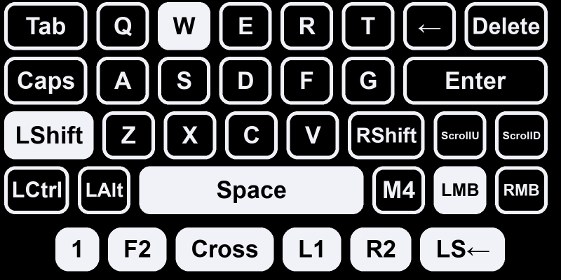

# InputDeck — keyboard & mouse

**English** · [Español](#español)

> This is the `keyboard-mouse` branch of InputDeck. The `main` branch draws the gamepad
> (Xbox / DualSense / Switch 2); this branch draws a compact **keyboard + mouse** instead, and
> shows gamepad buttons as key-style boxes.

Cross-platform input viewer (Windows / macOS / Linux) for OBS in a minimalist white-outline style.

<p align="center"></p>

## Features

- Compact keyboard (Tab · QWERT · Caps · ASDFG · Shift · ZXCV · Ctrl/Alt/Space) with the **mouse
  integrated**: left/right buttons, M4 and the scroll wheel (ScrollU / ScrollD). Pressed keys
  light up.
- Anything you press that is **not** on the grid (numbers, F-keys, arrows, other modifiers, middle
  click…) appears as a box below, **only while pressed**.
- **Gamepads** (Xbox, DualSense / DualShock 4, Switch 2 Pro Controller) show up as the same kind of
  box while you press them: `A`, `LB`, `Cross`, `ZR`, `D↑`… Triggers count as pressed past 30 %
  and sticks show an arrow (`LS↑`, `RS→`) when tilted.
- Left and right Shift / Ctrl / Alt are told apart.
- No lag: every press and release is an event, not sampled; short taps stay visible for a moment.
- Resizable window drawn at its real resolution (sharp in OBS).

## Usage

```bash
python -m venv .venv
# Windows:  .venv\Scripts\activate      macOS/Linux:  source .venv/bin/activate
pip install -r requirements.txt
python run.py
```

**G** toggles a green background (chroma key in OBS: Window Capture + "Color Key" filter
`#00B140`) and black. Preview without pressing anything: `python run.py --demo`.

## Build an executable

```bash
pip install pyinstaller
pyinstaller --noconfirm --onefile --windowed --name InputDeck --collect-all libusb_package --collect-binaries hid run.py
```

## Platform notes

- **Global keyboard/mouse** (pynput, in a separate process so the cursor doesn't lag while you
  move the window):
  - Windows: works without extra permissions (games running as administrator may require running
    the viewer as administrator too).
  - macOS: grant the program *Accessibility* / *Input Monitoring* permission.
  - Linux: requires X11 (does not work on pure Wayland).
- **Gamepads** use SDL GameController (Xbox, PlayStation…) and a custom USB backend for the
  Switch 2 Pro Controller (Windows only). If Steam is open, its desktop configuration can turn the
  controller into a mouse/keyboard on Windows; that is independent of this program.

## Project structure

```
inputviewer/
  keyboard.py      keyboard + mouse grid
  chips.py         gamepad state -> box names
  gamepad.py       SDL controller backend -> PadState
  switch2_usb.py   USB backend for the Switch 2 Pro Controller -> PadState
  keys.py          global keyboard and mouse (pynput, separate process)
  draw.py          drawing primitives
  app.py           window and main loop
run.py             entry point
```

## Credits and notices

- Switch 2 Pro Controller protocol:
  [switchbrew](https://switchbrew.org/wiki/Switch_2:_Pro_Controller) and
  [ndeadly/switch2_controller_research](https://github.com/ndeadly/switch2_controller_research).
- Xbox, PlayStation, DualSense and Nintendo Switch are trademarks of their respective owners. This
  project is independent and is not affiliated with or endorsed by them.

## License

[MIT](LICENSE)

---

# Español

[English](#inputdeck--keyboard--mouse) · **Español**

> Esta es la rama `keyboard-mouse` de InputDeck. La rama `main` dibuja el mando (Xbox / DualSense /
> Switch 2); esta dibuja un **teclado + ratón** compacto y muestra los botones del mando como
> cajitas, igual que las teclas.

Input viewer multiplataforma (Windows / macOS / Linux) para OBS con un estilo minimalista de
contornos blancos.

## Características

- Teclado compacto (Tab · QWERT · Caps · ASDFG · Shift · ZXCV · Ctrl/Alt/Espacio) con el **ratón
  integrado**: botones izquierdo/derecho, M4 y la rueda (ScrollU / ScrollD). Las teclas pulsadas se
  iluminan.
- Todo lo que pulses y **no** esté en la cuadrícula (números, F1-F12, flechas, otros modificadores,
  clic central…) aparece como una cajita debajo, **solo mientras se pulsa**.
- Los **mandos** (Xbox, DualSense / DualShock 4, Switch 2 Pro Controller) aparecen como el mismo
  tipo de cajita mientras los pulsas: `A`, `LB`, `Cross`, `ZR`, `D↑`… Los gatillos cuentan como
  pulsados a partir del 30 % y los sticks muestran una flecha (`LS↑`, `RS→`) al inclinarlos.
- Se distinguen Shift / Ctrl / Alt izquierdo y derecho.
- Sin retraso: cada pulsación y suelta es un evento, no un muestreo; los toques cortos se ven un
  instante.
- Ventana redimensionable que se dibuja a la resolución real (nítido en OBS).

## Uso

```bash
python -m venv .venv
# Windows:  .venv\Scripts\activate      macOS/Linux:  source .venv/bin/activate
pip install -r requirements.txt
python run.py
```

**G** alterna fondo verde (chroma key en OBS: Captura de ventana + filtro «Clave de color»
`#00B140`) y negro. Vista previa sin pulsar nada: `python run.py --demo`.

## Compilar un ejecutable

```bash
pip install pyinstaller
pyinstaller --noconfirm --onefile --windowed --name InputDeck --collect-all libusb_package --collect-binaries hid run.py
```

## Notas por plataforma

- **Teclado/ratón globales** (pynput, en un proceso aparte para no ralentizar el cursor al mover
  la ventana):
  - Windows: funciona sin permisos extra (los juegos como administrador pueden requerir ejecutar
    el viewer como administrador).
  - macOS: hay que dar permiso de *Accesibilidad* / *Monitorización de entrada* al programa.
  - Linux: requiere X11 (no funciona con Wayland puro).
- **Mandos:** usan SDL GameController (Xbox, PlayStation…) y un backend USB propio para el Switch 2
  Pro Controller (solo Windows). Si Steam está abierto, su configuración de escritorio puede
  convertir el mando en ratón/teclado en Windows; es independiente de este programa.

## Estructura

```
inputviewer/
  keyboard.py      cuadrícula de teclado + ratón
  chips.py         estado del mando -> nombres de cajitas
  gamepad.py       backend de mando SDL -> PadState
  switch2_usb.py   backend USB del Switch 2 Pro Controller -> PadState
  keys.py          teclado y ratón globales (pynput, proceso aparte)
  draw.py          primitivas de dibujo
  app.py           ventana y bucle principal
run.py             punto de entrada
```

## Créditos y avisos

- Protocolo del Switch 2 Pro Controller:
  [switchbrew](https://switchbrew.org/wiki/Switch_2:_Pro_Controller) y
  [ndeadly/switch2_controller_research](https://github.com/ndeadly/switch2_controller_research).
- Xbox, PlayStation, DualSense y Nintendo Switch son marcas de sus respectivos propietarios. Este
  proyecto es independiente y no está afiliado ni respaldado por ellos.

## Licencia

[MIT](LICENSE)
