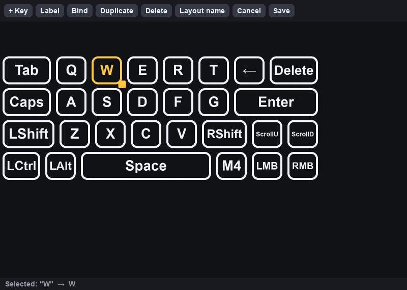
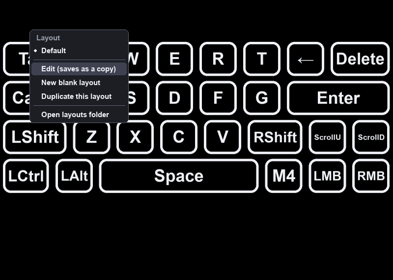

# InputDeck — keyboard & mouse

**English** · [Español](#español)

> This is the `keyboard-mouse` branch of InputDeck. The `main` branch draws the gamepad
> (Xbox / DualSense / Switch 2); this branch draws a **keyboard + mouse** you can fully
> customize, and shows gamepad buttons as key-style boxes.

Cross-platform input viewer (Windows / macOS / Linux) for OBS in a minimalist white-outline style.

<table>
  <tr>
    <td align="center"><br><sub>Default layout</sub></td>
    <td align="center"><br><sub>Layout editor</sub></td>
    <td align="center"><br><sub>Right-click menu</sub></td>
  </tr>
</table>

## Features

- **Fully customizable layouts:** move keys, resize them, rename them and change which input
  lights each one up. Save as many layouts as you want and switch between them (see
  [Custom layouts](#custom-layouts)).
- Default layout: a compact keyboard (Tab · QWERT · Caps · ASDFG · Shift · ZXCV · Ctrl/Alt/Space)
  with the **mouse integrated**: left/right buttons, M4 and the scroll wheel (ScrollU / ScrollD).
- Anything you press that is **not** in the current layout (numbers, F-keys, arrows, other
  modifiers, middle click…) appears as a box below, **only while pressed**.
- **Gamepads** (Xbox, DualSense / DualShock 4, Switch 2 Pro Controller) show up as the same kind of
  box while you press them: `A`, `LB`, `Cross`, `ZR`, `D↑`… Triggers count as pressed past 30 %
  and sticks show an arrow (`LS↑`, `RS→`) when tilted. Gamepad buttons can also be assigned to keys
  in your own layouts.
- Left and right Shift / Ctrl / Alt are told apart.
- No lag: every press and release is an event, not sampled; short taps stay visible for a moment.
- Resizable window drawn at its real resolution (sharp in OBS).

## Usage

```bash
python -m venv .venv
# Windows:  .venv\Scripts\activate      macOS/Linux:  source .venv/bin/activate
pip install -r requirements.txt
python run.py
```

**Right-click** opens the menu (choose, edit, create, duplicate or delete layouts). **G** toggles a
green background (chroma key in OBS: Window Capture + "Color Key" filter `#00B140`) and black.
Preview without pressing anything: `python run.py --demo`.

## Custom layouts

Right-click → **Edit this layout** (the built-in *Default* is never overwritten: editing it saves a
copy) or **New blank layout**. The editor lets you:

| Action | How |
|---|---|
| Move a key | Drag it (arrow keys nudge by 1, with Shift by 4) |
| Resize a key | Drag the small square at its bottom-right corner |
| Rename a key | Double-click it, or `F2` / `Enter` / **Label** |
| Change what it listens to | Select it, press `B` / **Bind**, then press the key, mouse button, scroll wheel or gamepad button you want |
| Add / duplicate / delete | `N` / `Ctrl+D` / `Del` (or the toolbar buttons) |
| Name the layout | **Layout name** |
| Save / cancel | `Ctrl+S` / **Save** · `Esc` / **Cancel** (asks before discarding changes) |

Layouts are plain JSON files in `%APPDATA%\InputViewer\layouts\` (macOS:
`~/Library/Application Support/InputViewer/layouts`, Linux: `~/.config/InputViewer/layouts`). Use
**Open layouts folder** in the menu to find them; you can share a layout by sending its file, and
anyone can drop it into their folder.

```json
{
  "schema": 1,
  "name": "My WASD",
  "keys": [
    { "label": "W", "bind": "W",     "x": 30, "y": 2,  "w": 24, "h": 22 },
    { "label": "Jump", "bind": "SPACE", "x": 2, "y": 52, "w": 100, "h": 22 },
    { "label": "Fire", "bind": "LMB",   "x": 110, "y": 52, "w": 30, "h": 22 },
    { "label": "A",    "bind": "PAD:A", "x": 150, "y": 52, "w": 24, "h": 22 }
  ]
}
```

`bind` is the input that lights the key: letters and digits (`Q`, `1`), `F1`–`F24`, `SPACE`, `ENTER`,
`TAB`, `ESC`, `BACK`, `DEL`, `CAPS`, `LShift`/`RShift`, `LCtrl`/`RCtrl`, `LAlt`/`RAlt`, `WIN`,
arrows (`↑ ↓ ← →`), `LMB`/`RMB`/`MMB`/`M4`/`M5`, `ScrollU`/`ScrollD`, or `PAD:<button>` for a
gamepad button. Invalid files are ignored, so a broken layout can never crash the app.

## Build an executable

```bash
pip install pyinstaller
pyinstaller --noconfirm --onefile --windowed --name InputDeck --collect-all libusb_package --collect-binaries hid run.py
```

## Platform notes

- **Global keyboard/mouse** (pynput, in a separate process so the cursor doesn't lag while you
  move the window):
  - Windows: works without extra permissions (games running as administrator may require running
    the viewer as administrator too).
  - macOS: grant the program *Accessibility* / *Input Monitoring* permission.
  - Linux: requires X11 (does not work on pure Wayland).
- **Gamepads** use SDL GameController (Xbox, PlayStation…) and a custom USB backend for the
  Switch 2 Pro Controller (Windows only). If Steam is open, its desktop configuration can turn the
  controller into a mouse/keyboard on Windows; that is independent of this program.

## Project structure

```
inputviewer/
  layout.py        layout model, validation and JSON storage
  editor.py        layout editor (move, resize, rename, bind)
  render.py        draws a layout and the boxes for unassigned inputs
  keyboard.py      data for the built-in default layout
  menu.py          right-click menu
  config.py        user data folder and preferences
  chips.py         gamepad state -> box names
  gamepad.py       SDL controller backend -> PadState
  switch2_usb.py   USB backend for the Switch 2 Pro Controller -> PadState
  keys.py          global keyboard and mouse (pynput, separate process)
  draw.py          drawing primitives
  app.py           window and main loop
run.py             entry point
```

## Credits and notices

- Switch 2 Pro Controller protocol:
  [switchbrew](https://switchbrew.org/wiki/Switch_2:_Pro_Controller) and
  [ndeadly/switch2_controller_research](https://github.com/ndeadly/switch2_controller_research).
- Xbox, PlayStation, DualSense and Nintendo Switch are trademarks of their respective owners. This
  project is independent and is not affiliated with or endorsed by them.

## License

[MIT](LICENSE)

---

# Español

[English](#inputdeck--keyboard--mouse) · **Español**

> Esta es la rama `keyboard-mouse` de InputDeck. La rama `main` dibuja el mando (Xbox / DualSense /
> Switch 2); esta dibuja un **teclado + ratón** totalmente personalizable y muestra los botones del
> mando como cajitas, igual que las teclas.

Input viewer multiplataforma (Windows / macOS / Linux) para OBS con un estilo minimalista de
contornos blancos.

## Características

- **Diseños totalmente personalizables:** mueve las teclas, cámbiales el tamaño y el nombre, y
  elige qué entrada ilumina cada una. Guarda todos los diseños que quieras y cambia entre ellos
  (ver [Diseños personalizados](#diseños-personalizados)).
- Diseño por defecto: teclado compacto (Tab · QWERT · Caps · ASDFG · Shift · ZXCV · Ctrl/Alt/Espacio)
  con el **ratón integrado**: botones izquierdo/derecho, M4 y la rueda (ScrollU / ScrollD).
- Todo lo que pulses y **no** esté en el diseño actual (números, F1-F12, flechas, otros
  modificadores, clic central…) aparece como una cajita debajo, **solo mientras se pulsa**.
- Los **mandos** (Xbox, DualSense / DualShock 4, Switch 2 Pro Controller) aparecen como el mismo
  tipo de cajita mientras los pulsas: `A`, `LB`, `Cross`, `ZR`, `D↑`… Los gatillos cuentan como
  pulsados a partir del 30 % y los sticks muestran una flecha (`LS↑`, `RS→`) al inclinarlos. Los
  botones del mando también se pueden asignar a teclas de tus propios diseños.
- Se distinguen Shift / Ctrl / Alt izquierdo y derecho.
- Sin retraso: cada pulsación y suelta es un evento, no un muestreo; los toques cortos se ven un
  instante.
- Ventana redimensionable que se dibuja a la resolución real (nítido en OBS).

## Uso

```bash
python -m venv .venv
# Windows:  .venv\Scripts\activate      macOS/Linux:  source .venv/bin/activate
pip install -r requirements.txt
python run.py
```

**Clic derecho** abre el menú (elegir, editar, crear, duplicar o borrar diseños). **G** alterna
fondo verde (chroma key en OBS: Captura de ventana + filtro «Clave de color» `#00B140`) y negro.
Vista previa sin pulsar nada: `python run.py --demo`.

## Diseños personalizados

Clic derecho → **Edit this layout** (el *Default* incluido nunca se sobrescribe: al editarlo se
guarda una copia) o **New blank layout**. En el editor puedes:

| Acción | Cómo |
|---|---|
| Mover una tecla | Arrástrala (las flechas la mueven de 1 en 1, con Mayús de 4 en 4) |
| Cambiar su tamaño | Arrastra el cuadradito de su esquina inferior derecha |
| Renombrarla | Doble clic, o `F2` / `Enter` / **Label** |
| Cambiar lo que escucha | Selecciónala, pulsa `B` / **Bind** y luego pulsa la tecla, botón del ratón, rueda o botón de mando que quieras asignar |
| Añadir / duplicar / borrar | `N` / `Ctrl+D` / `Supr` (o los botones de la barra) |
| Nombrar el diseño | **Layout name** |
| Guardar / cancelar | `Ctrl+S` / **Save** · `Esc` / **Cancel** (pregunta antes de descartar cambios) |

Los diseños son archivos JSON normales en `%APPDATA%\InputViewer\layouts\` (macOS:
`~/Library/Application Support/InputViewer/layouts`, Linux: `~/.config/InputViewer/layouts`). Usa
**Open layouts folder** en el menú para encontrarlos; puedes compartir un diseño enviando su
archivo, y cualquiera puede ponerlo en su carpeta.

El formato es el del ejemplo de arriba. `bind` es la entrada que ilumina la tecla: letras y
números (`Q`, `1`), `F1`–`F24`, `SPACE`, `ENTER`, `TAB`, `ESC`, `BACK`, `DEL`, `CAPS`,
`LShift`/`RShift`, `LCtrl`/`RCtrl`, `LAlt`/`RAlt`, `WIN`, flechas (`↑ ↓ ← →`),
`LMB`/`RMB`/`MMB`/`M4`/`M5`, `ScrollU`/`ScrollD`, o `PAD:<botón>` para un botón de mando. Los
archivos inválidos se ignoran, así que un diseño roto nunca puede bloquear la app.

## Compilar un ejecutable

```bash
pip install pyinstaller
pyinstaller --noconfirm --onefile --windowed --name InputDeck --collect-all libusb_package --collect-binaries hid run.py
```

## Notas por plataforma

- **Teclado/ratón globales** (pynput, en un proceso aparte para no ralentizar el cursor al mover
  la ventana):
  - Windows: funciona sin permisos extra (los juegos como administrador pueden requerir ejecutar
    el viewer como administrador).
  - macOS: hay que dar permiso de *Accesibilidad* / *Monitorización de entrada* al programa.
  - Linux: requiere X11 (no funciona con Wayland puro).
- **Mandos:** usan SDL GameController (Xbox, PlayStation…) y un backend USB propio para el Switch 2
  Pro Controller (solo Windows). Si Steam está abierto, su configuración de escritorio puede
  convertir el mando en ratón/teclado en Windows; es independiente de este programa.

## Estructura

```
inputviewer/
  layout.py        modelo de diseño, validación y guardado en JSON
  editor.py        editor de diseños (mover, redimensionar, renombrar, asignar)
  render.py        dibuja un diseño y las cajitas de entradas sin asignar
  keyboard.py      datos del diseño por defecto incluido
  menu.py          menú de clic derecho
  config.py        carpeta de datos del usuario y preferencias
  chips.py         estado del mando -> nombres de cajitas
  gamepad.py       backend de mando SDL -> PadState
  switch2_usb.py   backend USB del Switch 2 Pro Controller -> PadState
  keys.py          teclado y ratón globales (pynput, proceso aparte)
  draw.py          primitivas de dibujo
  app.py           ventana y bucle principal
run.py             punto de entrada
```

## Créditos y avisos

- Protocolo del Switch 2 Pro Controller:
  [switchbrew](https://switchbrew.org/wiki/Switch_2:_Pro_Controller) y
  [ndeadly/switch2_controller_research](https://github.com/ndeadly/switch2_controller_research).
- Xbox, PlayStation, DualSense y Nintendo Switch son marcas de sus respectivos propietarios. Este
  proyecto es independiente y no está afiliado ni respaldado por ellos.

## Licencia

[MIT](LICENSE)
