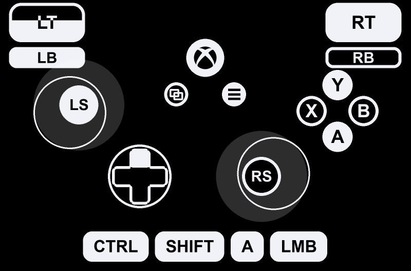
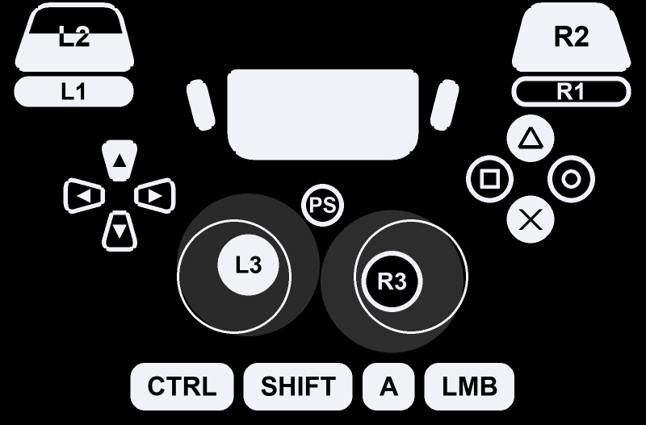
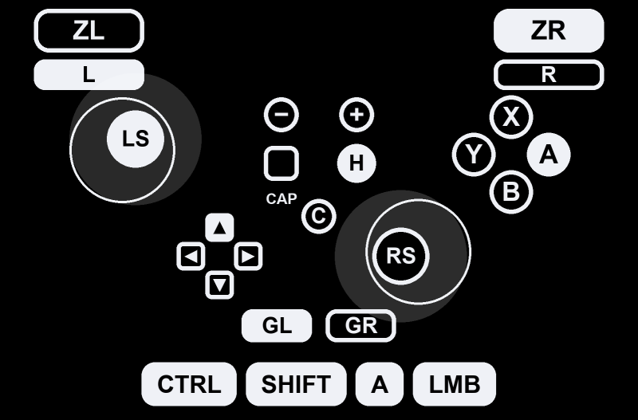

# InputDeck

**English** · [Español](#español)

Cross-platform input viewer (Windows / macOS / Linux) for OBS: shows your gamepad, keyboard and
mouse in a minimalist white-outline style.

<table>
  <tr>
    <td align="center"><br><sub>Xbox Series</sub></td>
    <td align="center"><br><sub>DualSense</sub></td>
  </tr>
  <tr>
    <td align="center"><br><sub>Switch 2 Pro Controller</sub></td>
    <td align="center"><br><sub>Right-click layout picker / Selector de diseño (clic derecho)</sub></td>
  </tr>
</table>

<sub>Screenshots show some buttons pressed, the sticks glowing and a few keyboard/mouse keys.
· Las capturas muestran botones pulsados, los sticks brillando y algunas teclas/ratón.</sub>

## Features

| Controller | Connection | Status |
|---|---|---|
| Xbox Series X\|S (and any controller with an SDL mapping) | USB / Bluetooth | ✅ Xbox Series layout |
| DualSense (PS5) / DualShock 4 | USB / Bluetooth | ✅ PlayStation layout (via SDL) |
| Nintendo Switch 2 Pro Controller | USB | ✅ custom backend, Windows only |

- **Auto-detection:** switches layout depending on the connected controller. A Switch 2 Pro
  Controller over USB takes priority; otherwise the first controller SDL sees is used.
- **Manual picker:** right-click to choose the layout you prefer, even if the controller is a
  different type (your choice is saved).
- Analog triggers that fill as you press them; sticks that glow as they move.
- Keyboard keys and mouse buttons below the controller, **only while they are pressed**.
- Resizable window drawn at its real resolution (sharp in OBS).
- With no controller connected it shows "Waiting for a controller to connect…".
- **Keeps capturing when minimized (Windows):** Windows stops drawing minimized windows, so OBS's
  *Window Capture* freezes or goes black. With **Keep capturing when minimized** (right-click menu,
  on by default), the minimize button makes the window invisible and click-through instead, while
  OBS keeps capturing it live. Click its button in the taskbar to bring it back.
- **Start with Windows:** a checkbox in the right-click menu that makes the program launch when you
  sign in. It only affects your user (no administrator rights) and writes a single entry in
  `HKCU\Software\Microsoft\Windows\CurrentVersion\Run`, named after the executable, so the two
  editions don't overwrite each other. Untick it in the same menu, or in Windows' *Startup apps*.
  If you move the `.exe`, untick and tick it again so the entry points to the new location.

## Usage

```bash
python -m venv .venv
# Windows:  .venv\Scripts\activate      macOS/Linux:  source .venv/bin/activate
pip install -r requirements.txt
python run.py
```

**Right-click** opens the layout menu (Auto, Xbox, PlayStation or Switch 2). Your choice is saved
in `%APPDATA%\InputViewer\config.json` (macOS: `~/Library/Application Support/InputViewer`,
Linux: `~/.config/InputViewer`). When you force a layout, buttons are converted by physical
position (e.g. Xbox A, at the bottom, lights up Nintendo B, also at the bottom).

The same right-click menu has a **Background** section: green (chroma key in OBS: Window Capture +
"Color Key" filter `#00B140`) or black. Your choice is remembered.

## Build an executable

```bash
pip install pyinstaller
pyinstaller --noconfirm --onefile --windowed --name InputDeck --collect-all libusb_package --collect-binaries hid run.py
```

## Platform notes

- **Controller:** uses SDL GameController, so button names are identical on every OS. The
  DualSense touchpad click depends on SDL exposing it on your system.
- **Global keyboard/mouse** (pynput, in a separate process so the cursor doesn't lag while you
  move the window):
  - Windows: works without extra permissions (games running as administrator may require running
    the viewer as administrator too). Likewise, keys pressed while an elevated window has the focus
    (for example OBS run as administrator) are not seen by a normal viewer.
  - macOS: you must grant the program *Accessibility* / *Input Monitoring* permission.
  - Linux: requires X11 (does not work on pure Wayland).
- The mouse wheel is not shown.
- **Steam:** if Steam is open, its desktop configuration can turn the controller into a
  mouse/keyboard on Windows; that is independent of this program (which only reads the controller).
- **Switch 2 Pro Controller:** Windows does not expose it as a standard gamepad, so it is
  initialized over USB with custom commands and then its HID reports are read. The protocol comes
  from community research and may change with firmware updates.

## Project structure

```
inputviewer/
  gamepad.py       SDL controller backend (Xbox, PlayStation...) -> common PadState
  switch2_usb.py   USB backend for the Switch 2 Pro Controller -> PadState
  adapt.py         converts buttons between controller families (for the manual picker)
  keys.py          global keyboard and mouse (pynput, separate process)
  draw.py          drawing primitives
  xbox.py / playstation.py / switch2.py   visual layouts
  background.py    keep capturing when minimized (Windows)
  startup.py       start with Windows (Run registry entry)
  menu.py          right-click menu
  config.py        user preferences
  app.py           window, auto-detection and main loop
run.py             entry point
```

To add another controller: create a backend that returns a `PadState` (with its `kind`) and a
layout with a `draw(painter, pad)` function, then register it in `LAYOUTS` (`app.py`).

Preview the look without a controller: `python run.py --demo xbox|playstation|switch2|none`.

## Credits and notices

- Switch 2 Pro Controller protocol:
  [switchbrew](https://switchbrew.org/wiki/Switch_2:_Pro_Controller) and
  [ndeadly/switch2_controller_research](https://github.com/ndeadly/switch2_controller_research).
- The Xbox logo on the Guide button comes from [Simple Icons](https://simpleicons.org/) (CC0).
- Xbox, PlayStation, DualSense and Nintendo Switch are trademarks of their respective owners. This
  project is independent and is not affiliated with or endorsed by them.

## License

[MIT](LICENSE)

---

# Español

[English](#inputdeck) · **Español**

Input viewer multiplataforma (Windows / macOS / Linux) para OBS: muestra el mando, el teclado y
el ratón con un estilo minimalista de contornos blancos.

## Características

| Mando | Conexión | Estado |
|---|---|---|
| Xbox Series X\|S (y cualquier mando con mapeo SDL) | USB / Bluetooth | ✅ interfaz Xbox Series |
| DualSense (PS5) / DualShock 4 | USB / Bluetooth | ✅ interfaz PlayStation (vía SDL) |
| Nintendo Switch 2 Pro Controller | USB | ✅ backend propio, solo Windows |

- **Autodetección:** cambia de distribución según el mando conectado. Si hay un Switch 2 Pro
  Controller por USB tiene prioridad; si no, se usa el primer mando que vea SDL.
- **Selector manual:** clic derecho para elegir la distribución que prefieras, aunque el mando
  sea de otro tipo (se guarda).
- Gatillos analógicos que se rellenan según lo pulsado; sticks con brillo al moverse.
- Teclas y botones del ratón bajo el mando, **solo mientras se pulsan**.
- Ventana redimensionable que se dibuja a la resolución real (nítido en OBS).
- Sin mando conectado muestra «Waiting for a controller to connect…».
- **Sigue capturando al minimizar (Windows):** Windows deja de dibujar las ventanas minimizadas, así
  que la *Captura de ventana* de OBS se congela o se queda en negro. Con **Keep capturing when
  minimized** (menú de clic derecho, activada por defecto), el botón de minimizar hace la ventana
  invisible y transparente a los clics en vez de minimizarla, y OBS la sigue capturando en vivo.
  Pulsa su botón en la barra de tareas para recuperarla.
- **Arrancar con Windows:** una casilla en el menú de clic derecho para que el programa se abra al
  iniciar sesión. Solo afecta a tu usuario (sin permisos de administrador) y escribe una única
  entrada en `HKCU\Software\Microsoft\Windows\CurrentVersion\Run`, con el nombre del ejecutable, así
  que las dos ediciones no se pisan. Se quita desde el mismo menú o desde *Aplicaciones de inicio*
  de Windows. Si mueves el `.exe`, desmárcala y vuelve a marcarla para que apunte a la nueva ruta.

## Uso

```bash
python -m venv .venv
# Windows:  .venv\Scripts\activate      macOS/Linux:  source .venv/bin/activate
pip install -r requirements.txt
python run.py
```

**Clic derecho** abre el menú de distribución (Auto, Xbox, PlayStation o Switch 2). La elección
se guarda en `%APPDATA%\InputViewer\config.json` (macOS: `~/Library/Application Support/InputViewer`,
Linux: `~/.config/InputViewer`). Al forzar una distribución, los botones se convierten por
posición física (p. ej. la A de Xbox, abajo, ilumina la B de Nintendo, también abajo).

El mismo menú de clic derecho tiene una sección **Background**: verde (chroma key en OBS: Captura
de ventana + filtro «Clave de color» `#00B140`) o negro. Tu elección se recuerda.

## Compilar un ejecutable

```bash
pip install pyinstaller
pyinstaller --noconfirm --onefile --windowed --name InputDeck --collect-all libusb_package --collect-binaries hid run.py
```

## Notas por plataforma

- **Mando:** usa SDL GameController, así que los nombres de botón son idénticos en todos los SO.
  El clic del touchpad del DualSense depende de que SDL lo exponga en tu sistema.
- **Teclado/ratón globales** (pynput, en un proceso aparte para no ralentizar el cursor al mover
  la ventana):
  - Windows: funciona sin permisos extra (los juegos como administrador pueden requerir ejecutar
    el viewer como administrador). Igualmente, las teclas que pulses mientras una ventana elevada
    tiene el foco (por ejemplo OBS ejecutado como administrador) no las ve un viewer normal.
  - macOS: hay que dar permiso de *Accesibilidad* / *Monitorización de entrada* al programa.
  - Linux: requiere X11 (no funciona con Wayland puro).
- La rueda del ratón no se muestra.
- **Steam:** si Steam está abierto, su configuración de escritorio puede convertir el mando en
  ratón/teclado en Windows; es independiente de este programa (que solo lee el mando).
- **Switch 2 Pro Controller:** Windows no lo expone como gamepad estándar, así que se inicializa
  por USB con comandos propios y luego se leen sus reportes HID. El protocolo sale de la
  investigación de la comunidad y puede cambiar con actualizaciones de firmware.

## Estructura

```
inputviewer/
  gamepad.py       backend de mando SDL (Xbox, PlayStation...) -> PadState común
  switch2_usb.py   backend USB del Switch 2 Pro Controller -> PadState
  adapt.py         convierte botones entre familias de mandos (para el selector manual)
  keys.py          teclado y ratón globales (pynput, proceso aparte)
  draw.py          primitivas de dibujo
  xbox.py / playstation.py / switch2.py   distribuciones visuales
  background.py    seguir capturando al minimizar (Windows)
  startup.py       arrancar con Windows (entrada Run del registro)
  menu.py          menú de clic derecho
  config.py        preferencias del usuario
  app.py           ventana, autodetección y bucle principal
run.py             punto de entrada
```

Para añadir otro mando: crear un backend que devuelva `PadState` (con su `kind`) y una
distribución con una función `draw(painter, pad)`, y registrarla en `LAYOUTS` (`app.py`).

Probar el aspecto sin mando: `python run.py --demo xbox|playstation|switch2|none`.

## Créditos y avisos

- Protocolo del Switch 2 Pro Controller:
  [switchbrew](https://switchbrew.org/wiki/Switch_2:_Pro_Controller) y
  [ndeadly/switch2_controller_research](https://github.com/ndeadly/switch2_controller_research).
- El logo de Xbox del botón Guide procede de [Simple Icons](https://simpleicons.org/) (CC0).
- Xbox, PlayStation, DualSense y Nintendo Switch son marcas de sus respectivos propietarios. Este
  proyecto es independiente y no está afiliado ni respaldado por ellos.

## Licencia

[MIT](LICENSE)
